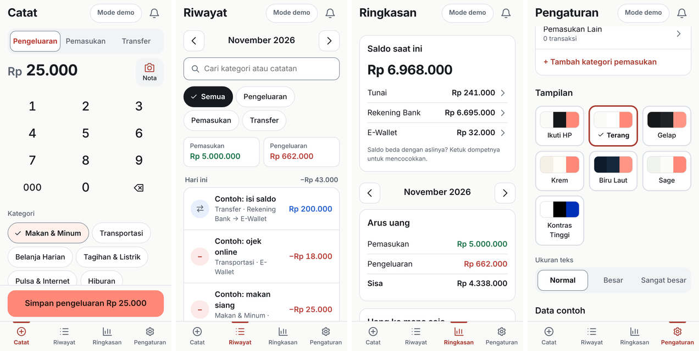
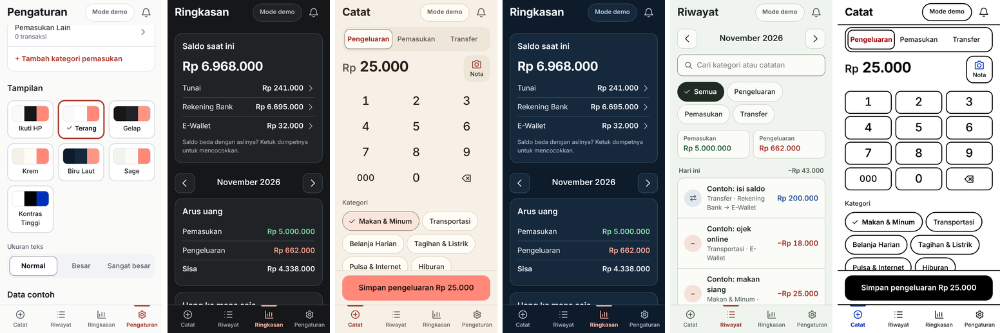

# Kemana

**Uangmu ke mana aja?** Kemana adalah aplikasi pencatat keuangan yang simpel. Kamu cukup mencatat uang masuk, uang keluar dan pindahan antar dompet, lalu aplikasi menunjukkan **uangmu ke mana saja**.

Datanya tersimpan di **Google Sheets milikmu sendiri**. Tidak ada server, tidak ada akun tambahan, dan tidak ada pihak ketiga yang menyimpan datamu.

**Coba langsung (mode demo, tanpa login):** https://adityairvndn.github.io/kemana-app/?demo



## Fitur

- **Catat dalam hitungan detik**: ketik nominal, pilih kategori dan dompet, lalu simpan. Jenisnya ada tiga: Pengeluaran, Pemasukan dan Transfer antar dompet.
  - **Catat cepat**: transaksi yang sering berulang (parkir, bensin, kopi) muncul sebagai tombol. Sekali ketuk langsung tersimpan, dan bisa dibatalkan.
  - **Kategori paling sering dipakai** otomatis ada di depan.
  - **Baca nota**: foto nota atau pilih screenshot (bukti transfer, checkout, e-wallet). Nominal, tanggal, nama toko atau penerima, dan tebakan kategori langsung terisi. Kamu tinggal cek, lalu simpan. Lihat [Baca nota](#baca-nota).
- **Riwayat**: dikelompokkan per hari dan bisa dicari (kategori, catatan atau nominal) serta difilter per jenis, kategori atau dompet. Ketuk transaksi untuk mengubah atau menghapusnya.
- **Ringkasan**:
  - saldo tiap dompet; ketuk dompetnya untuk **mencocokkan saldo** dengan yang asli;
  - pemasukan dan pengeluaran bulan ini;
  - "Uang ke mana saja" per kategori; ketuk kategorinya untuk melihat transaksinya;
  - sumber pemasukan;
  - tren 6 bulan.
- **Cocokkan saldo**: lupa mencatat? Ketik saldo yang sebenarnya, dan selisihnya dicatat sebagai «Tidak tercatat». Saldo kembali sama, dan kamu tetap tahu berapa uang yang lepas dari catatan.
- **Mulai dengan saldo yang benar**: setelah spreadsheet dibuat (atau data contoh dihapus), aplikasi menanyakan uangmu ada di mana saja dan berapa saldonya.
- **Dompet dan kategori bebas diatur**: tambah, ganti nama (riwayat ikut berubah), sembunyikan, atau hapus kalau belum pernah dipakai.
- **Tetap jalan tanpa internet**: catatan disimpan di perangkat dan dikirim ke spreadsheet begitu online.
- **6 tema dan 3 ukuran teks**, supaya nyaman dipakai siapa saja:

  | Tema | Cocok untuk |
  | --- | --- |
  | Terang | Bawaan, putih hangat dengan aksen koral |
  | Gelap | Malam hari, hemat baterai di layar OLED |
  | Krem | Hangat dan lembut di mata, tidak silau |
  | Biru Laut | Gelap kebiruan (navy), lebih berkarakter dari Gelap |
  | Sage | Hijau pucat yang tenang |
  | Kontras tinggi | Penglihatan kurang, garis tebal dan teks tegas |

  Ada juga pilihan **Ikuti HP**, yang otomatis memakai tema terang atau gelap sesuai pengaturan perangkat. Ukuran teksnya: Normal, Besar dan Sangat besar.

  

- **Mode demo**: coba semua fitur tanpa login, datanya hanya di perangkat itu.
- **Bisa dipasang seperti aplikasi** di Android, iPhone/iPad, Windows, macOS dan Linux (PWA).

## Baca nota

Tombol **Nota** di layar Catat membaca tulisan dari foto atau screenshot memakai [Tesseract](https://github.com/tesseract-ocr/tesseract) (lewat [tesseract.js-core](https://github.com/naptha/tesseract.js-core), WebAssembly) dengan model bahasa Indonesia.

- **Diproses di HP-mu.** Foto tidak dikirim atau disimpan ke mana pun.
- **Hanya mengisi, tidak menyimpan.** Hasilnya selalu dicek dulu oleh pengguna. Kalau ada beberapa angka yang mungkin, angka lainnya tampil sebagai pilihan sekali ketuk.
- **Diunduh sekali saat pertama dipakai** (±4 MB), lalu disimpan di perangkat sehingga bisa dipakai tanpa internet. Yang tidak memakai fitur ini tidak ikut mengunduhnya.
- **Paling akurat untuk screenshot** (bukti transfer, checkout, e-wallet). Untuk struk cetak yang pudar, kusut atau tulisan tangan, angkanya bisa salah baca.
- **Berjalan di browser modern** (Chrome, Edge, Safari, Firefox). Perangkat lama yang belum mendukung WebAssembly SIMD memakai versi cadangan yang lebih lambat.

Logika membaca total, tanggal, nama toko dan tebakan kategori ada di `js/nota.js` dan dites dengan contoh di `tests/nota/`.

## Privasi

Aplikasi meminta izin Google `drive.file` saja. Artinya aplikasi **hanya bisa membuka file yang ia buat sendiri**. File lain di Google Drive-mu tidak bisa dilihat, apalagi diubah. Izin ini tergolong *non-sensitive* oleh Google.

Semua permintaan dikirim langsung dari browser-mu ke Google. Pemilik situs tempat aplikasi ini dipasang tidak menerima datamu.

## Cara pakai

1. Buka alamat aplikasinya, misalnya `https://namamu.github.io/kemana/`.
2. Ketuk **Masuk dengan Google** dan pilih akunnya.
3. Kalau belum punya spreadsheet, aplikasi membuatkannya. Kamu bisa memilih **dengan data contoh** (17 transaksi untuk dilihat-lihat) atau kosong. Kalau sudah punya, aplikasi langsung menyambung ke spreadsheet itu.
4. Isi saldo tiap dompetmu saat ini, misalnya Tunai, BCA dan GoPay. Namanya bebas.
5. Mulai mencatat.

**Memasang di layar utama:**

- **Android (Chrome)**: menu ⋮ lalu **Instal aplikasi** atau **Tambahkan ke layar utama**.
- **iPhone/iPad (Safari)**: tombol Bagikan lalu **Tambahkan ke Layar Utama**.
- **Komputer (Chrome/Edge)**: ikon instal di ujung kanan kolom alamat.

**Membuka spreadsheet-nya:** Pengaturan, lalu **Buka di Google Sheets**. Kamu boleh menambah, mengubah atau menghapus baris langsung di sana. Aplikasi membaca ulang setiap kali dibuka.

## Spreadsheet dan "pakem"-nya

Spreadsheet berisi 4 sheet: **Transaksi**, **Dompet**, **Kategori** dan **Info**.

- **Isinya bebas**, judul kolomnya yang dipakemkan. Kamu boleh menambah atau menghapus baris sesukamu.
- **Urutan kolom boleh diubah**, dan kamu boleh menambah kolom sendiri. Kolom tambahanmu dibiarkan apa adanya.
- **Judul kolom jangan diganti.** Aplikasi mengenali kolom dari judulnya, bukan dari posisinya.
- **Baris yang tidak valid tidak membuat aplikasi rusak.** Contohnya tanggal kosong atau nominal bukan angka. Baris itu dilewati dan ditampilkan di Pengaturan, lengkap dengan nomor barisnya.

Daftar lengkap kolom dan aturannya ada di [SCHEMA.md](SCHEMA.md).

**Kalau nanti ada kolom baru:** begitu aplikasi versi baru dibuka, ia memeriksa spreadsheet, menambahkan sheet atau kolom yang belum ada, lalu memberi tahu pengguna apa saja yang ditambahkan. Data lama tidak disentuh.

---

## Memasang versimu sendiri (gratis)

Kamu butuh akun GitHub dan akun Google. Ini cukup dilakukan sekali, sekitar 15 menit.

### 1. Taruh di GitHub Pages

1. Buat repo **publik** baru di GitHub, misalnya `kemana`, lalu unggah semua file di folder ini.
2. Di repo itu buka **Settings**, lalu **Pages**. Di bagian **Build and deployment**, pilih **Source: Deploy from a branch**, branch `main`, folder `/ (root)`, lalu **Save**.
3. Tunggu sekitar 1 menit. Alamatnya akan menjadi `https://<username>.github.io/kemana/`.

### 2. Buat Client ID Google

Buka [Google Cloud Console](https://console.cloud.google.com/).

1. **Buat project baru**, misalnya bernama `Kemana`.
2. **Aktifkan API.** Buka **APIs & Services**, lalu **Library**. Cari dan aktifkan (**Enable**) dua API ini:
   - **Google Sheets API**
   - **Google Drive API**
3. **Atur layar izin.**
   1. Buka **Google Auth Platform**, lalu **Branding**, lalu **Get started**.
   2. Isi nama aplikasi dan email dukungan.
   3. Pilih **Audience: External**.
   4. Isi email kontak, centang persetujuan, lalu **Create**.
4. **Tambahkan izin.** Buka **Data Access**, lalu **Add or remove scopes**. Centang `https://www.googleapis.com/auth/drive.file`, lalu **Save**.
5. **Buat Client ID.**
   1. Buka **Clients**, lalu **Create client**, dan pilih jenis **Web application**.
   2. Di **Authorized JavaScript origins**, tambahkan:
      - `https://<username>.github.io` (hanya domainnya, tanpa `/kemana`);
      - `http://localhost:8000` (opsional, untuk mencoba di komputer).
   3. Klik **Create**, lalu salin **Client ID**-nya. Bentuknya seperti `1234…-abcd….apps.googleusercontent.com`.
6. **Buka untuk umum.** Buka **Audience**, lalu **Publish app**.
   - Selama masih *Testing*, hanya akun yang didaftarkan sebagai *Test users* yang bisa masuk.
   - Karena aplikasi hanya memakai izin non-sensitive, tidak perlu proses review data. Verifikasi *brand* hanya diperlukan kalau kamu ingin nama dan logo aplikasi tampil di layar izin Google.

### 3. Isi `js/config.js`

```js
GOOGLE_CLIENT_ID: '1234…-abcd….apps.googleusercontent.com',
REPO_URL: 'https://github.com/<username>/kemana',   // opsional
```

Client ID **bukan rahasia** dan aman ditaruh di repo publik, karena ia hanya berlaku di alamat yang kamu daftarkan di langkah 2.5. Commit dan push perubahannya. Selesai.

### Mencoba di komputer

```bash
npm start          # http://localhost:8000 (butuh Python 3; server statis apa pun juga bisa)
npm test           # tes logika inti (Node 18+)
```

- `http://localhost:8000/?demo` langsung masuk ke mode demo.
- Login Google hanya bisa di alamat yang terdaftar sebagai *Authorized JavaScript origins*.

## Merilis versi baru

Aplikasi tersimpan di HP sebagai satu paket berversi, jadi terbuka instan dan tetap jalan tanpa sinyal. Versi baru diunduh di latar belakang. Pengguna melihat pesan **Versi baru Kemana sudah siap** dan mengetuk **Pakai sekarang**. Kalau diabaikan, versi baru dipakai otomatis saat aplikasi dibuka lagi setelah ditutup. Data pengguna ada di spreadsheet, jadi tidak ikut hilang.

**Setiap rilis, tambahkan satu entri di paling atas `js/kabar.js`** (daftar "Kabar Kemana" di tombol lonceng, ditulis dengan bahasa sehari-hari untuk pengguna awam). `npm test` memeriksa entri teratas sama dengan `APP_VERSION`. Pengguna melihat titik merah di lonceng sampai membuka kabarnya.

**Setiap rilis, naikkan nomor versi di tiga tempat dengan angka yang sama:**

1. `APP_VERSION` di `js/config.js`
2. `VERSION` di `sw.js`
3. `version` di `package.json`

Kalau `VERSION` di `sw.js` lupa dinaikkan, HP yang sudah memasang aplikasi **tidak akan menerima pembaruan**. Karena itu `npm test` memeriksa ketiganya sama, dan juga memeriksa bahwa semua file aplikasi masuk daftar `SHELL` di `sw.js`. File baru yang tidak masuk daftar itu tidak akan tersedia saat offline.

Biarkan baris `APP_VERSION: '…'` di `js/config.js` dalam format persis itu (kutip tunggal). Setelah rilis, CDN GitHub Pages bisa beberapa menit masih menyajikan sebagian file lama. Supaya HP tidak menyimpan campuran file lama dan baru, `sw.js` mengunduh tiap file lewat alamat berversi (`?v=…`) dan menolak memasang kalau `config.js` dari server belum bertanda versi yang sama. Browser mencoba lagi saat aplikasi dibuka berikutnya. Jadi wajar kalau pesan "Versi baru siap" baru muncul beberapa menit setelah merge.

**Kalau versi baru butuh kolom atau sheet baru**, lakukan juga ini sebelum push:

1. Di `js/schema.js`:
   - naikkan `SCHEMA_VERSION`, misalnya dari 1 ke 2;
   - tambahkan kolomnya di `SHEETS` dengan `since: 2`;
   - tambahkan `def` kalau baris lama perlu nilai bawaan.
2. Push.

Saat pengguna membuka aplikasi, kolom baru ditambahkan di ujung kanan sheet. Pengguna lalu melihat pesan **Spreadsheet diperbarui** berisi daftar perubahannya.

**Aturan untuk pengembang:**

- **Jangan pernah mengganti nama atau menghapus kolom lama.** Kalau terpaksa mengganti nama, masukkan nama lamanya ke `aliases` supaya spreadsheet lama tetap terbaca.
- **Spreadsheet yang dibuat versi lebih baru** tetap dibuka. Pengguna hanya diberi tahu bahwa aplikasinya perlu diperbarui.

## Batasan yang perlu kamu tahu

- **Sambung ulang tiap sekitar 1 jam.** Akses Google dari aplikasi web berlaku sekitar 1 jam, dan tanpa server tidak bisa diperpanjang diam-diam.
  - Setelah itu, cukup ketuk **Sambungkan** sekali. Biasanya langsung tersambung tanpa memilih akun lagi.
  - Selama belum tersambung, mencatat tetap bisa. Catatan menunggu di perangkat.
- **Tidak ada notifikasi pengingat**, karena notifikasi terjadwal butuh server.
- **Hanya spreadsheet buatan aplikasi yang bisa dibuka**, karena izinnya `drive.file`. Kalau kamu menyalin spreadsheet secara manual, salinannya tidak bisa dibuka aplikasi.
- **Sebaiknya jangan ubah baris yang sama di aplikasi dan di Google Sheets pada saat bersamaan.** Perubahan yang terakhir tersimpan yang berlaku.

## Isi folder

| File | Isi |
| --- | --- |
| `index.html`, `css/app.css` | Tampilan. Token warna enam tema ada di bagian atas `css/app.css`; ikon UI berupa sprite SVG di `index.html` (`<use href="#i-nama">`). Font memakai font bawaan sistem, tanpa unduhan |
| `docs/design.md` | Panduan desain dan UX Kemana: prinsip, token, aturan tiap layar, aksesibilitas, dan skenario uji |
| `js/app.js` | Alur aplikasi dan layar |
| `js/schema.js` | Pakem spreadsheet: sheet, kolom, versi dan migrasi |
| `js/sheets.js` | Baca dan tulis Google Sheets |
| `js/google.js` | Login Google (Google Identity Services) |
| `js/compute.js` | Hitungan saldo, ringkasan dan riwayat |
| `js/format.js` | Format rupiah dan tanggal |
| `js/nota.js` | Membaca total, tanggal, toko dan kategori dari teks nota |
| `js/ocr.js`, `js/ocr-worker.js` | Menjalankan pembaca tulisan (OCR) di perangkat |
| `vendor/tesseract/` | Mesin OCR (tesseract.js-core 7.0.0) dan model bahasa Indonesia (tessdata_fast), keduanya berlisensi Apache 2.0 |
| `js/config.js` | **Pengaturan yang kamu isi** |
| `sw.js`, `manifest.webmanifest` | Supaya bisa dipasang dan dibuka offline |
| `js/boot.js`, `js/nomodule.js` | Memasang tema sebelum tampil (mencegah kedip warna), dan pesan untuk browser yang terlalu lama |
| `icons/` | Ikon aplikasi (huruf k di atas gradien petrol): `icon.svg` (favicon dan logo), `favicon-32.png`, PNG 192/512, `maskable` untuk Android, 180 untuk iPhone |
| `tests/` | Tes logika inti dan pemeriksaan rilis (`npm test`) |

## Lisensi

[MIT](LICENSE): bebas dipakai, diubah dan dibagikan.

File di `vendor/tesseract/` berasal dari [tesseract.js-core](https://github.com/naptha/tesseract.js-core) dan [tessdata_fast](https://github.com/tesseract-ocr/tessdata_fast), berlisensi Apache 2.0 (salinan lisensinya ada di folder yang sama).

## Rujukan

- [Choose Google Drive API scopes](https://developers.google.com/workspace/drive/api/guides/api-specific-auth): `drive.file` termasuk non-sensitive.
- [Configure the OAuth consent screen](https://developers.google.com/workspace/guides/configure-oauth-consent)
- [Submit for brand verification](https://developers.google.com/identity/protocols/oauth2/production-readiness/brand-verification)
- [Google Identity Services: token model](https://developers.google.com/identity/oauth2/web/guides/use-token-model)
- [GitHub Pages: configuring a publishing source](https://docs.github.com/en/pages/getting-started-with-github-pages/configuring-a-publishing-source-for-your-github-pages-site)
